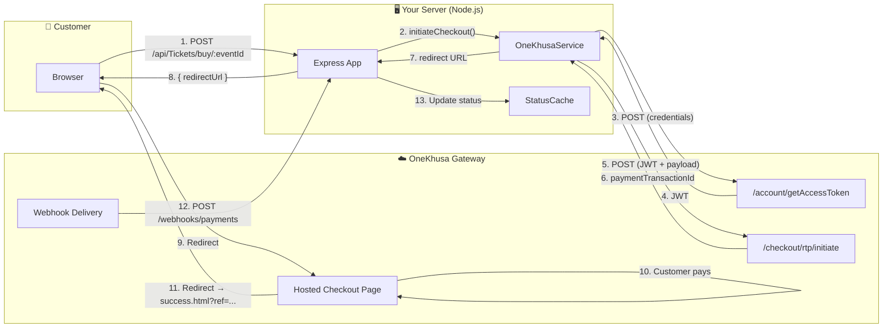
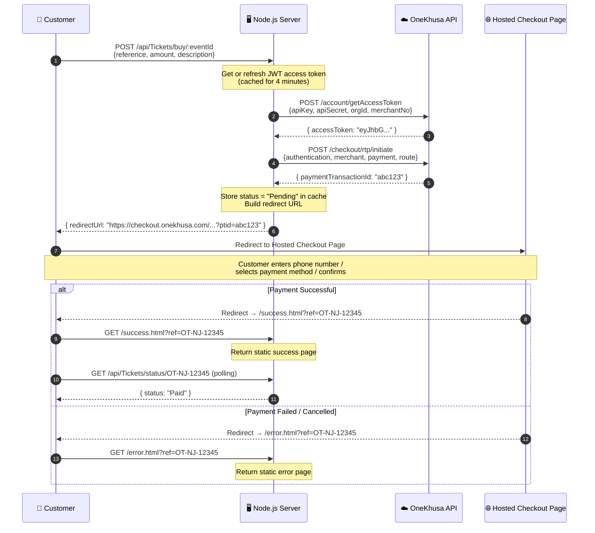
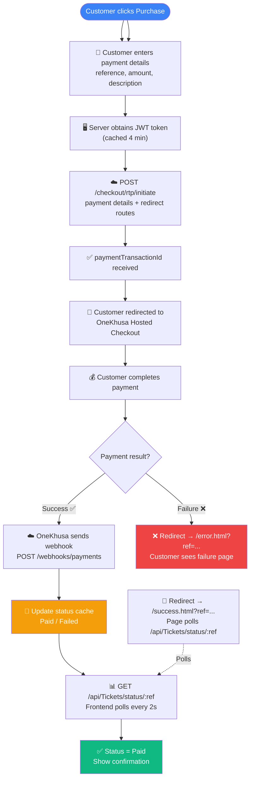
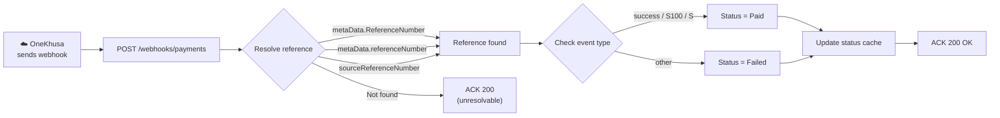
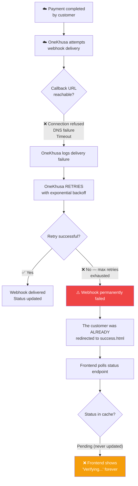

# OneKhusa Hosted Checkout — Node.js Integration

A clean, production-ready Node.js integration with the **OneKhusa Payment Gateway** using the **Request to Pay (RTP) Hosted Checkout** flow. The customer is redirected to a managed checkout page hosted by OneKhusa to complete payment — no card data ever touches your server.

---

## Table of Contents

- [Architecture](#architecture)
- [Hosted Checkout Flow](#hosted-checkout-flow)
- [Request to Pay — Full Lifecycle](#request-to-pay--full-lifecycle)
- [Webhook Processing](#webhook-processing)
- [When the Callback URL Is Unreachable or Invalid](#when-the-callback-url-is-unreachable-or-invalid)
- [Setup & Installation](#setup--installation)
- [API Endpoints](#api-endpoints)
- [Configuration](#configuration)
- [Project Structure](#project-structure)

---

## Architecture



---

## Hosted Checkout Flow

This is the primary payment flow. The customer enters payment details on your page, then is redirected to OneKhusa's managed checkout to complete the transaction.



### Step-by-Step Breakdown

| Step | What Happens |
|------|-------------|
| 1 | Customer fills in **reference**, **amount**, and **description** on your page and clicks "Purchase" |
| 2 | Your server obtains a **JWT access token** from OneKhusa (cached for 4 minutes) |
| 3 | Your server calls `POST /checkout/rtp/initiate` with payment details and redirect routes |
| 4 | OneKhusa returns a `paymentTransactionId` |
| 5 | Your server builds the **hosted checkout redirect URL** and returns it to the browser |
| 6 | The browser **redirects the customer** to the OneKhusa-hosted checkout page |
| 7 | The customer completes payment on the hosted page (USSD prompt, mobile money, etc.) |
| 8 | On **success**, OneKhusa redirects to `success.html?ref=...` — your page polls `/api/Tickets/status/:ref` until status is `Paid` |
| 9 | On **failure**, OneKhusa redirects to `error.html?ref=...` — the customer sees a failure message and can retry |
| 10 | Independently, OneKhusa sends a **webhook** to `/webhooks/payments` confirming the result |

---

## Request to Pay — Full Lifecycle

This diagram shows the complete lifecycle including the background webhook that runs **in parallel** with the customer-facing redirect flow.



---

## Webhook Processing

OneKhusa sends a `POST` request to your `callbackApiUrl` whenever a payment status changes. The webhook is the **source of truth** — the polling on the frontend is just a convenience layer.



### Webhook Payload Structure

OneKhusa may send the reference in different fields. The handler checks all of them:

```
metaData.ReferenceNumber    ← TitleCase (most common)
metaData.referenceNumber    ← camelCase
sourceReferenceNumber       ← top-level
payment.sourceReferenceNumber ← nested
```

### Success Detection

A payment is considered successful if **any** of these conditions are true:

| Field | Value |
|-------|-------|
| `eventType` / `event` / `type` | Contains `"success"` |
| `responseCode` | `"S100"` or starts with `"S"` |
| `transactionStatusCode` | `"S"` |

---

## When the Callback URL Is Unreachable or Invalid

This is a critical scenario to understand. The `callbackApiUrl` in the checkout initiation payload tells OneKhusa where to send the webhook. Here's what happens when it fails:

### Scenario: Callback URL is Unreachable (e.g., ngrok is down)



### What Actually Happens — In Detail

| Aspect | Behaviour |
|--------|-----------|
| **Customer experience** | The customer is **still redirected** to `success.html` or `error.html` because the redirect happens via the browser, not the webhook. The hosted checkout page sends the customer back regardless of webhook delivery. |
| **Webhook retries** | OneKhusa implements **automatic retries** with exponential backoff. If your server is temporarily down (e.g., ngrok tunnel restarted), the webhook will succeed on a later retry. |
| **Status remains "Pending"** | If the webhook never arrives, the status cache stays at `"Pending"`. The frontend polling will keep showing "Verifying Payment..." indefinitely. |
| **No data loss** | OneKhusa keeps a record of the transaction. You can reconcile later by querying the OneKhusa dashboard or using their API. |

### Mitigation Strategies

| Strategy | Description |
|----------|-------------|
| **Use a stable URL** | Avoid ngrok in production. Use a real domain with HTTPS. |
| **Health check endpoint** | Add a `GET /health` route and monitor it. |
| **Dashboard reconciliation** | Periodically check the OneKhusa merchant portal for transactions that never received a webhook. |
| **Idempotent webhook handler** | Our handler is idempotent — if OneKhusa retries, receiving the same webhook twice is safe. The status cache simply gets overwritten with the same value. |
| **Graceful frontend timeout** | Add a timeout to the polling loop so the customer sees a "Taking too long? Check your email" message instead of spinning forever. |

### Scenario: Callback URL is Invalid (e.g., wrong path)

| Situation | What Happens |
|-----------|-------------|
| URL points to a non-existent route | OneKhusa gets a **404 Not Found** response. This is treated as a delivery failure and retried. |
| URL points to a route that returns non-200 | Same as above — any response outside `200-299` is a failure. |
| URL has wrong protocol (http vs https) | May cause SSL/TLS errors. OneKhusa logs the failure and retries. |
| URL is malformed | OneKhusa rejects it at initiation time — you'll get an API error when calling `/checkout/rtp/initiate`. |

> **Important:** The `successRedirectionUrl` and `failureRedirectionUrl` are **browser redirects** (not webhooks). They work independently of the `callbackApiUrl`. Even if the callback URL is wrong, the customer will still be redirected to your success or error page.

---

## Setup & Installation

### Prerequisites

- **Node.js** ≥ 18
- **OneKhusa** sandbox credentials (API key, secret, org ID, merchant number)
- **ngrok** (for local development) or a public URL

### Install & Run

```bash
# Clone / navigate to the project
cd onekhusa-nodejs-integration

# Install dependencies
npm install

# Copy and configure environment variables
cp .env.example .env
# Edit .env with your credentials

# Start the server
npm start
```

### Using ngrok

```bash
# In a separate terminal, tunnel port 8080
ngrok http 8080

# Copy the HTTPS URL (e.g., https://abc123.ngrok-free.dev)
# and set it as PUBLIC_CALLBACK_URL in your .env
```

### Run in Development Mode

```bash
# Auto-restarts on file changes
npm run dev
```

---

## API Endpoints

| Method | Path | Description |
|--------|------|-------------|
| `GET` | `/` | Dashboard — customer payment form |
| `POST` | `/api/Tickets/buy/:eventId` | Initiate a hosted checkout payment |
| `GET` | `/api/Tickets/status/:reference` | Poll payment status (`Pending`, `Paid`, `Failed`, `NotFound`) |
| `POST` | `/webhooks/payments` | OneKhusa webhook callback |
| `GET` | `/success.html` | Success redirect page (polls status, shows confirmation) |
| `GET` | `/error.html` | Failure redirect page (shows error, retry link) |

---

## Configuration

All configuration is driven by environment variables. Copy `.env.example` to `.env` and fill in your values.

| Variable | Description | Default |
|----------|-------------|---------|
| `ONEKHUSA_API_KEY` | Your sandbox/production API key | — |
| `ONEKHUSA_API_SECRET` | Your sandbox/production API secret | — |
| `ONEKHUSA_ORG_ID` | Organisation ID | — |
| `ONEKHUSA_MERCHANT_NUMBER` | Merchant account number | — |
| `ONEKHUSA_TOKEN_URL` | Token endpoint | `https://api.onekhusa.com/sandbox/v1/account/getAccessToken` |
| `ONEKHUSA_CHECKOUT_URL` | Checkout initiation endpoint | `https://api.onekhusa.com/sandbox/v1/checkout/rtp/initiate` |
| `ONEKHUSA_CHECKOUT_REDIRECT_URL` | Hosted checkout page base URL | `https://checkout.onekhusa.com/requestToPay/initiate` |
| `PUBLIC_CALLBACK_URL` | Your public URL (ngrok or domain) | — |
| `PORT` | Server port | `8080` |

---

## Project Structure

```
onekhusa-nodejs-integration/
├── .env                      # Environment variables (not committed)
├── .env.example              # Template for .env
├── package.json
├── public/
│   ├── index.html            # Customer payment form
│   ├── success.html          # Success redirect page (polls for confirmation)
│   └── error.html            # Failure redirect page
└── src/
    ├── app.js                # Express entry point
    ├── config/
    │   └── index.js          # Centralized configuration from env
    ├── routes/
    │   └── index.js          # Route handlers (buy, status, webhook)
    ├── services/
    │   └── onekhusa.service.js   # OneKhusa API wrapper (token, checkout)
    └── utils/
        └── statusCache.js    # TTL-backed in-memory status cache
```

---

## License

ISC
