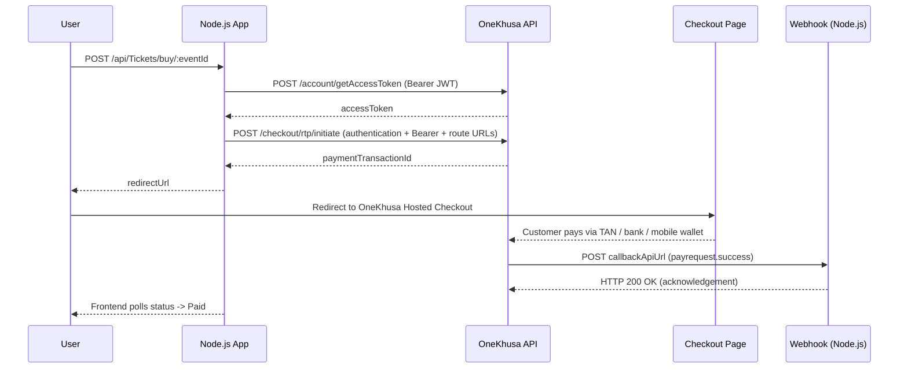
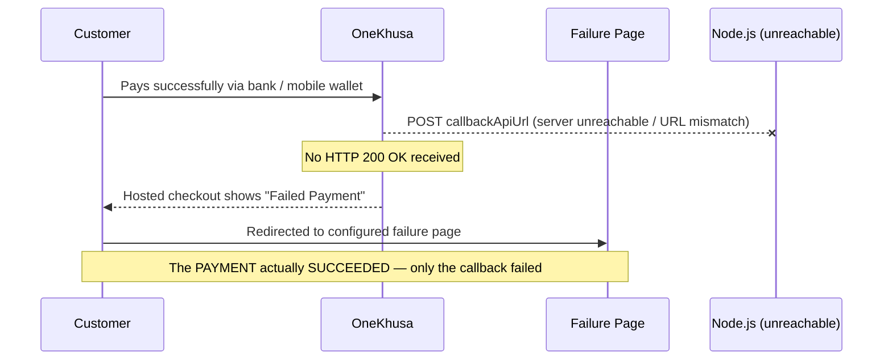

# OneKhusa Hosted Checkout — Technical Walkthrough

A Node.js integration with the **OneKhusa Payment Gateway** (sandbox) that demonstrates the complete **Hosted Checkout** flow — and, most importantly, what happens when the **callback URL is not reachable or does not match**.

The project implements a single **Hosted Checkout** flow behind a clean, config-driven service layer: the customer enters their payment details, is redirected to OneKhusa's managed payment page, completes the payment there, and is redirected back when the callback completes.

Payment confirmations are delivered via OneKhusa **webhooks** (`payrequest.success`) and stored in the cache so the frontend can poll status without touching the API. Every inbound webhook is **signature-verified locally** (HMAC-SHA512, timing-safe comparison) before the transaction is finalised.

---

## 🚀 Features

- **Service-Oriented Architecture** — all OneKhusa API logic lives in `src/services/onekhusa.service.js`.
- **Config-driven** — every endpoint and credential is resolved through `src/config/index.js` (no scattered `process.env` calls).
- **Authenticated API calls** — obtains a short-lived JWT via `POST /account/getAccessToken` and sends it as `Authorization: Bearer`, with the required body `authentication` block for checkout endpoints.
- **Token caching** — access tokens are cached (240s) to avoid hitting the token endpoint on every request.
- **Idempotent requests** — every call includes an `X-Idempotency-Key` header.
- **Webhook handling** — verifies the `X-OneKhusa-Webhook-Signature` HMAC-SHA512 against the raw body, then confirms payments and acknowledges with HTTP 200.
- **Status polling** — the frontend polls a lightweight endpoint backed by an in-memory TTL cache.

---

## 📂 Project Structure

```text
onekhusa-nodejs-integration/
├── public/
│   ├── index.html            # Customer payment form
│   ├── success.html          # Success redirect page (polls for confirmation)
│   └── error.html            # Failure redirect page
├── src/
│   ├── app.js                # Express entry point
│   ├── config/
│   │   └── index.js          # Centralized configuration from env
│   ├── middleware/
│   │   └── verifyWebhookSignature.js  # HMAC-SHA512 webhook verification
│   ├── routes/
│   │   └── index.js          # Route handlers (buy, status, webhook)
│   ├── services/
│   │   └── onekhusa.service.js   # OneKhusa API wrapper (token, checkout)
│   └── utils/
│       ├── statusCache.js    # TTL-backed in-memory status cache
│       └── webhookSecurity.js # HMAC-SHA512 compute/verify helpers
├── test/
│   └── webhookVerification.test.js  # Signature + end-to-end webhook tests
├── .env                      # Credentials (never commit)
├── .env.example              # Template for .env
├── package.json              # Node.js dependencies
└── README.md                 # This file
```

---

## 🛠️ Setup

> No database or migrations required — the demo runs entirely on an **in-memory TTL cache**.

### 1. Install dependencies

```bash
npm install
```

### 2. Configure environment

Copy `.env.example` to `.env`, then fill in the **sandbox credentials issued to you in the OneKhusa merchant portal**:

```env
ONEKHUSA_API_KEY=
ONEKHUSA_API_SECRET=
ONEKHUSA_ORG_ID=YOUR_ORG_ID
ONEKHUSA_MERCHANT_NUMBER=

# Webhook signature verification secret (separate from the API secret)
ONEKHUSA_WEBHOOK_SECRET=

# Public callback URL (your ngrok URL in development)
PUBLIC_CALLBACK_URL=https://your-id.ngrok-free.dev
```

| Env variable | What it is | Where to find it |
| ------------ | ---------- | ---------------- |
| `ONEKHUSA_API_KEY` | Your sandbox **API key** | OneKhusa merchant portal → **API / Credentials** |
| `ONEKHUSA_API_SECRET` | Your sandbox **API secret** | OneKhusa merchant portal → **API / Credentials** |
| `ONEKHUSA_ORG_ID` | Your **organisation ID** | OneKhusa merchant portal → **Organisation / Account settings** |
| `ONEKHUSA_MERCHANT_NUMBER` | Your **merchant account number** | OneKhusa merchant portal → **Merchant / Accounts** |
| `ONEKHUSA_WEBHOOK_SECRET` | Secret used to **verify inbound webhooks** | OneKhusa merchant portal → **Webhook settings** |
| `PUBLIC_CALLBACK_URL` | Public URL OneKhusa uses for redirects + webhooks | Your ngrok URL in development |

> ⚠️ Use **your own** portal values — do not copy credentials from another merchant. If a key is ever exposed, rotate it in the merchant portal.

### 3. Start the server

```bash
npm start
```

---

## 🧪 Try the Demo

Follow these steps to test the **Hosted Checkout** flow end-to-end.

### 1. Start the app

```bash
npm start
```

Open **http://localhost:8080** in your browser — you should see the **OneTicket Fintech** dashboard.

### 2. Expose your app with ngrok (needed for the callback)

The hosted checkout only completes when OneKhusa can reach your **callback API URL**. In a second terminal:

```bash
ngrok http 8080
```

Copy the `https://...ngrok-free.dev` URL and set it in `.env`:

```env
PUBLIC_CALLBACK_URL=https://your-id.ngrok-free.dev
```

Then restart the server: `npm start`.

### 3. Test the Hosted Checkout flow

1. On the dashboard, click **Generate** for a reference number, or type your own.
2. Enter an **Amount** and a **Description**, then click **PURCHASE WITH HOSTED CHECKOUT**.
3. You are redirected to the **OneKhusa Hosted Checkout** page.
4. Complete the (sandbox) payment — the page provides a **TAN** to use.
5. You are redirected back to `/success.html?ref=...`, the syncing overlay appears, and the **Payment Confirmed!** success screen shows once the status is updated to `Paid`.

> Watch the callback arrive in the logs:
> ```bash
> # Look for "OneKhusa webhook verified" + "status updated to PAID"
> ```

### 4. Test the callback-failure scenario (optional)

To see what happens when the callback is unreachable:

1. Stop ngrok (or set a wrong `PUBLIC_CALLBACK_URL`).
2. Repeat step 3 — complete the payment on the hosted page.
3. The checkout page shows **Failed Payment** and you are sent to the failure page, **even though the payment succeeded**.
4. Restore ngrok / the correct URL to fix it. See the [Troubleshooting](#-troubleshooting--what-to-do--which-files-to-check) section.

---

## 🔌 API Endpoints

| Method | Endpoint | Description |
| ------ | -------- | ----------- |
| `GET`  | `/` | Dashboard — customer payment form |
| `POST` | `/api/Tickets/buy/:eventId` | Initiate hosted checkout. Body: `reference`, `amount`, `description`. Returns `redirectUrl` to the hosted checkout page. |
| `GET`  | `/api/Tickets/status/:reference` | Poll status for a checkout reference. |
| `POST` | `/webhooks/payments` | OneKhusa event endpoint (`payrequest.success`). Requires a valid `X-OneKhusa-Webhook-Signature`; responds `401` otherwise. |

### Statuses

Statuses are cached per reference: `Pending` → `Paid` | `Failed` | `NotFound`.

---

## 📡 Webhook Setup (ngrok)

```bash
ngrok http 8080
```

1. Copy the generated URL into `PUBLIC_CALLBACK_URL` in your `.env`.
2. Register `https://your-id.ngrok-free.dev/webhooks/payments` as the callback URL in the OneKhusa portal.
3. Copy the **webhook secret** from the portal's webhook settings into `ONEKHUSA_WEBHOOK_SECRET`.
4. Restart the server: `npm start`.

---

## 🔐 Webhook Signature Verification

The callback endpoint is public, so anyone who learns the URL could POST a
fake "payment succeeded". Every webhook is therefore verified **before** the
transaction is finalised.

### How it works

| Step | Detail |
| ---- | ------ |
| **Extract headers** | `X-OneKhusa-Webhook-Signature` (the HMAC) and the webhook event code |
| **Read the raw payload** | The exact, unparsed request bytes — captured by `express.raw()` **before** `express.json()` runs |
| **Compute the local hash** | `HMAC-SHA512(ONEKHUSA_WEBHOOK_SECRET, rawBody)` as lowercase hex |
| **Timing-safe compare** | `crypto.timingSafeEqual()` against the header value |
| **Finalise** | Only if the signature matches is the payload parsed and the status written |

> **Header name gotcha.** The published guide calls the event header
> `OneKhusa-Webhook-Event`, but the live gateway sends
> **`X-Onekhusa-Webhook-Event`** (with the `X-` prefix). Both spellings are
> accepted, so the event name resolves either way — see
> `webhookSignatureHeaders` / `webhookEventHeaders` in `src/config/index.js`.

### Where it lives

| File | Role |
| ---- | ---- |
| `src/utils/webhookSecurity.js` | `computeSignature()` / `verifySignature()` — pure, reusable HMAC helpers |
| `src/middleware/verifyWebhookSignature.js` | Express middleware: header → raw body → verify → parse |
| `src/routes/index.js` | Applies the middleware to `POST /webhooks/payments` |
| `src/app.js` | Mounts `express.raw()` for `/webhooks` ahead of `express.json()` |

### Response codes

| Code | Meaning |
| ---- | ------- |
| `200` | Signature valid — the payload was processed and acknowledged |
| `400` | Signature valid but the body is missing or not JSON |
| `401` | Missing or mismatched signature — **nothing is processed** |
| `500` | `ONEKHUSA_WEBHOOK_SECRET` is not configured (fails closed) |

### ⚠️ Rules this implementation holds to

- **Always hash the raw body.** Re-serialising parsed JSON changes whitespace
  and key order, so the digest would never match — this is why `express.raw()`
  runs before `express.json()`.
- **Always compare in constant time.** `timingSafeEqual()` prevents an attacker
  from recovering the expected signature byte by byte via response timings.
- **Fail closed.** A missing secret rejects webhooks rather than silently
  trusting them.

> OneKhusa's signature covers the body only — there is no timestamp or nonce in
> the digest, so **replay protection is not possible at this layer**. If replay
> matters to your integration, gate on `paymentTransactionId` and treat duplicate
> callbacks as idempotent no-ops in the handler.

### Testing it

```bash
npm test
```

Covers the HMAC helpers plus end-to-end webhook delivery: valid signatures,
wrong secret, missing header, tampered body, pretty-printed and BOM-prefixed
bodies, and event-header fallback. No test dependencies required — it runs on
Node's built-in test runner.

You can also exercise it by hand. Sign a body with your secret, then send it:

```bash
BODY='{"eventType":"payrequest.success","metaData":{"ReferenceNumber":"TEST-1"},"responseCode":"S100"}'

SIG=$(node -e "const c=require('crypto');process.stdout.write(
  c.createHmac('sha512', process.env.ONEKHUSA_WEBHOOK_SECRET)
   .update(process.argv[1],'utf8').digest('hex'))" "$BODY")

curl -X POST http://localhost:8080/webhooks/payments \
  -H 'Content-Type: application/json' \
  -H "X-OneKhusa-Webhook-Signature: $SIG" \
  -H 'OneKhusa-Webhook-Event: payrequest.success' \
  --data-binary "$BODY"

curl http://localhost:8080/api/Tickets/status/TEST-1   # -> {"status":"Paid"}
```

Remove the signature header and the same request returns `401`.

---

## 🧠 How It Works

### Hosted Checkout Flow

The process starts when your application sends a `POST` request to the OneKhusa **Request to Pay initiate endpoint**. The request includes:

- The required **`X-Idempotency-Key`** header.
- A **`route`** object containing the three URLs that drive the flow:
  - **success redirection URL** — where the customer goes when the callback succeeds.
  - **failure redirection URL** — where the customer goes when the callback fails.
  - **callback API URL** — where OneKhusa sends the server-to-server payment notification.

> The same integration flow applies regardless of the technology stack — this demo happens to use Node.js with Express.



Once the request is successfully initiated, OneKhusa returns a **payment transaction ID** and your app redirects the customer to the **OneKhusa Hosted Checkout**. The customer completes the payment using a **TAN** (Timed Account Number). OneKhusa then sends a **server-to-server POST** to your **callback API URL**. Your server **must** respond with **HTTP 200 OK** — this acknowledgment confirms to OneKhusa that the payment notification was received. Only then does the checkout flow complete and the customer get redirected to the configured **success page**.

---

## ⚠️ When the Callback URL Is Not Reachable (or Does Not Match)

This is the most important scenario to understand.

**The customer completes the payment successfully** through their bank or mobile wallet. OneKhusa then attempts to send the payment payload to the **callback API URL** provided during initiation. If that URL is **incorrect or unreachable**:

1. Our server cannot be reached, so it **cannot return `HTTP 200 OK`**.
2. Because the callback was not delivered, the OneKhusa checkout page displays **Failed Payment**.
3. The customer is redirected to the configured **failure page**.



**Here is the important part: the payment itself was successful.** The failure shown on the checkout page happened because OneKhusa could not communicate the payment confirmation to your system through the callback URL.

> **Key takeaway: a successful payment and a successful callback are two separate parts of the Hosted Checkout flow.** Your callback endpoint must be reachable **and** must acknowledge the payment notification (`HTTP 200 OK`) for the checkout flow to complete successfully.

### Callback URL Checklist

If you see **Failed Payment** on the Hosted Checkout even though the customer completed the payment, verify the callback URL:

1. ✅ Is **correct** — matches the URL registered in the OneKhusa portal.
2. ✅ Uses **HTTPS**.
3. ✅ Is **publicly accessible** from the internet (not `localhost`).
4. ✅ **Accepts POST requests**.
5. ✅ **Returns `HTTP 200 OK`** after receiving the payment notification.

For local development, remember that OneKhusa **cannot reach a callback running only on `localhost`**. Use a tool such as **ngrok** to expose your local application through a public HTTPS URL.

---

## 🔍 Troubleshooting — What to Do & Which Files to Check

### If you are a customer seeing "Failed Payment"

- Your payment may still have **succeeded** even though the page shows failure — keep the confirmation from your bank/mobile wallet.
- **Keep your reference number / TAN** and any transaction details.
- **Contact the merchant / support** and provide the reference. The merchant can confirm the payment and the callback status on their side.

### If you are a developer

| Symptom | What to check | Which file |
| ------- | ------------- | ---------- |
| Callback never arrives | `PUBLIC_CALLBACK_URL` value; ngrok tunnel is running | `.env` |
| Endpoint/base URL wrong | Endpoint configuration (base URL, checkout, redirect) | `src/config/index.js` |
| Where the 3 route URLs are built | `successRedirectionUrl`, `failureRedirectionUrl`, `callbackApiUrl` | `src/services/onekhusa.service.js` |
| Webhook route missing or method wrong | Route registration (`POST /webhooks/payments`) | `src/routes/index.js` |
| Webhook received but status not updating | Handler logic (`isSuccess` → update cache, ack 200) | `src/routes/index.js` |
| **Webhook returns `401`** | `signature MISMATCH` in the log → the secret is wrong. `HEADER ABSENT` → the sender isn't OneKhusa (or a bot/scanner) | `.env` |
| **Webhook returns `500`** | `ONEKHUSA_WEBHOOK_SECRET` is not set — webhooks fail closed until it is | `.env` |
| **Webhook returns `400`** | Signature passed but the body is not JSON — inspect the raw request | `src/middleware/verifyWebhookSignature.js` |
| Signature always mismatches | `express.raw()` must run **before** `express.json()` for `/webhooks` | `src/app.js` |
| Payment processed but page not reflecting it | Frontend status-polling logic (`pollStatus`) | `public/success.html` |

**Fastest check:** look at your terminal output for `OneKhusa webhook verified`.

- If it is **not** there → either OneKhusa never reached your callback URL (verify the ngrok URL, `.env`, and the route), or the request was **rejected** — look for `Webhook rejected:` right above it.
- If it **is** there but the customer still saw a failure → confirm your response sent `HTTP 200 OK` (it does unless an exception is thrown).
